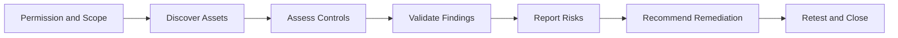

# From Learning Labs to Real Cybersecurity Work

A common student question is: **"How would this knowledge actually be used in a company?"**

GoHackersCloud's learning materials can show the relationship between safe practice environments and the structured workflows of cybersecurity services.

**Explore the service offering:** https://gohackerscloud.com/cybersecurity-services

> The examples here illustrate professional workflows. They are **not** customer case studies, claims of employment, supervised production assignments or evidence that learners work on GHC customer engagements.

## How a security assessment works

Students can imitate the **documentation and reasoning** stages inside a fictional or explicitly authorized environment, without testing someone else's systems.

## Learning-to-service alignment

| Learning activity | Professional workflow it introduces | Suggested portfolio artifact |
| --- | --- | --- |
| Linux permissions | Secure configuration and hardening review | Configuration assessment |
| HTTP and API labs | Web/API security assessment | Finding with impact, evidence and fix |
| Cloud IAM exercise | Cloud security configuration review | Least-privilege review matrix |
| Log analysis | SOC investigation and incident triage | Synthetic incident timeline |
| Container inspection | Platform/container security review | Risk and remediation checklist |
| Security policy review | Governance, risk and compliance | Control mapping and gap register |

These are illustrative links to industry practices; specific services and eligibility should be confirmed on the official GHC services page.

## Example: cloud IAM review

**Scenario:** a fictional company gives its reporting application broad permissions.

**Learner objective:** identify what the application truly needs.

1. Read the role's purpose and define authorized scope.
2. In an isolated simulator, inspect synthetic permissions.
3. Compare permissions with the application's actual responsibilities.
4. Document unnecessary privilege and potential business impact.
5. Propose a least-privilege policy and verification steps.
6. Produce a one-page executive summary and evidence appendix.

**Interview explanation:** "I reviewed an intentionally over-permissive IAM example in a training environment, identified unused access and prepared a remediation plan." Do not represent it as a real client assessment.

## Why documentation matters

Employers and clients care not only about commands, but also about scope, ethics, risk, communication, evidence, reproducibility and retest quality.

[Career guidance](../guidance/README.md) · [Projects](../projects/README.md) · [Academy](../academy/README.md)

## Work through a complete fictional engagement

Use the [GHC Professional Practice Series](../projects/professional-practice/README.md) to prepare a scope document, traceable evidence register, findings, remediation and retest plan, and an executive report for a synthetic scenario. The stages mirror **workflow concepts**, not actual GHC customer work.
