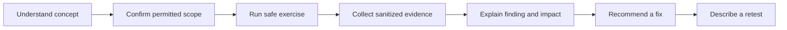

# Certification-Aligned Practical Projects

**Learn with GHC** connects concepts to documented, ethical practice. These projects use synthetic fixtures or localhost-only systems, so learners can practice without premium hardware, paid cloud accounts or authorization to test external targets.

| Project | Theme | Environment | Deliverable |
| --- | --- | --- | --- |
| [CEH 01 — Local Service Observation](./ceh-local-service-observation/README.md) | Scope, service discovery, HTTP evidence | Python 3 on your own computer | Service observation and recommendations |
| [OSCP 01 — Assessment Methodology](./oscp-synthetic-assessment/README.md) | Scoping, finding validation, impact, reporting and retest | Offline synthetic evidence | Professional-style assessment report |
| [Cloud 01 — AWS IAM Policy Review](./cloud-iam-policy-review/README.md) | Least privilege and cloud security control analysis | Offline Python 3 | IAM risk review and proposed mitigation |

These are **independent educational exercises**, not official CEH, OffSec or AWS exam content. They do not represent full exam simulators, assessment authorization, or actual customer work.

## Common practice workflow

## Before sharing a portfolio report

- Replace any real name, host, IP, account number, access key or credential with synthetic placeholders.
- Clearly label your work as an independent training scenario.
- Include scope, evidence, reasoning, remediation, limitations and cleanup.
- Cite course material or external references you used; don't copy proprietary paid content.
- Review [the professional report template](./ASSESSMENT-REPORT-TEMPLATE.md).

## Where this fits with GoHackersCloud

- [GHC Academy](../../academy/README.md) — conceptual learning and structured courses
- [GHC Labs](../../ghc-labs/README.md) — eligible guided browser-based practical training
- [Certification roadmaps](../../certification-plan/README.md) — choose a relevant pathway
- [Cybersecurity Services workflow](../../industry-practice/README.md) — understand how real engagements organize scope, evidence, reporting and remediation

GHC Cybersecurity Services are commercial services, **not** learner access to live customer environments.

[All projects](../README.md) · [Learning Hub](../../README.md)
