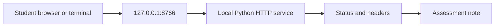

# CEH Practice 01 — Local Service Observation and Reporting

**Time:** 45–60 minutes · **Level:** Beginner / intermediate · **Requirements:** Python 3 and a terminal · **Cost:** No paid lab or cloud account needed.

**Objective:** understand service observation, minimal authorized discovery, HTTP evidence collection, and clear reporting. This exercise uses a **loopback-only service on your own device**. It is independent learning material, not an official CEH practical exam task.

## Concepts before commands

- **Authorization:** even discovery and scanning require permission on systems you do not own.
- **Listening service:** a process may accept TCP connections at a specified interface and port.
- **Scope:** 127.0.0.1 is local to your computer; do not substitute a real domain or other person's IP.
- **Evidence:** a response proves what was observed at that moment, not that the service is vulnerable.

## Architecture



## Step 1 — Prepare a synthetic target

In a terminal with Python 3:

```bash
mkdir -p "$HOME/ghc-ceh-local-01"
cd "$HOME/ghc-ceh-local-01"
printf 'Authorized local GHC CEH practice service\n' > index.html
python3 -m http.server 8766 --bind 127.0.0.1
```

Leave that terminal open. It creates a simple local web service and binds only to loopback.

**Expected:** a serving message mentioning port 8766. If you see `Address already in use`, choose a free port and update the commands consistently.

## Step 2 — Observe the permitted service

Open a second terminal:

```bash
curl -i http://127.0.0.1:8766/
```

**Expected:** an HTTP 200 response and the synthetic text. Headers such as `Server`, `Date` and `Content-Type` may vary by Python version.

## Step 3 — Compare an absent resource

```bash
curl -i http://127.0.0.1:8766/no-such-page
```

**Expected:** HTTP 404. Explain why a 404 status is an observation, not evidence of a security vulnerability.

## Step 4 — Explain network exposure

Answer in your report:

1. What is the distinction between listening on `127.0.0.1` and `0.0.0.0`?
2. Which commands establish that the service responded?
3. What evidence would you collect before recommending a configuration change?
4. Why must a penetration tester agree on scope before enumerating external systems?

Do **not** switch the demo server to a public interface to test these ideas.

## Step 5 — Write a professional observation

Use [the report template](../ASSESSMENT-REPORT-TEMPLATE.md).

Example training observation: *A synthetic HTTP service was reachable on the local loopback interface at port 8766 and served a demo file. No security weakness was established.*

For real-world context, browse the [GHC Cybersecurity Services overview](https://gohackerscloud.com/cybersecurity-services) and describe how rules of engagement, evidence handling, and responsible communication differ from an unsupervised experiment.

## Step 6 — Cleanup

Stop the Python server using **Ctrl+C**. Then run:

```bash
rm -f -- "$HOME/ghc-ceh-local-01/index.html"
rmdir -- "$HOME/ghc-ceh-local-01"
```

Only run cleanup if you created this directory specifically for the exercise.

## Troubleshooting

- `python3: command not found`: use an authorized environment with Python 3.
- `curl` missing: visit the localhost URL with a browser and record the observed status.
- Connection refused: confirm that the first terminal is still running.
- Port unavailable: stop the conflicting local service or choose another unused port.

## Connect to learning

[CEH roadmap](../../../certification-plan/ceh/README.md) · [Academy](../../../academy/README.md) · [GHC Labs](../../../ghc-labs/README.md) · [Certification projects](../README.md)
