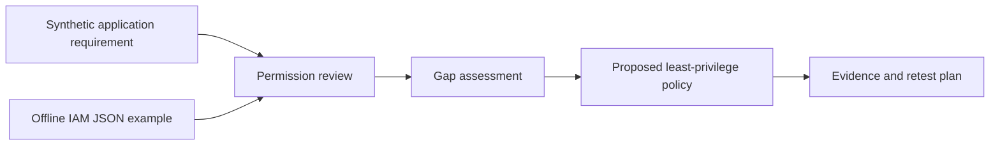

# Cloud Security Practice 01 — Offline AWS IAM Policy Review

**Time:** 60 minutes · **Level:** Beginner/intermediate · **Requirements:** Python 3 · **Cloud account:** Not required.

## Why this matters

Cloud security engineers frequently review access policies for least privilege. A policy may grant far more access than an application needs, increasing risk if credentials are compromised. This project uses a **fictional AWS-style IAM policy** and does not access AWS.

## Scenario and objective

A synthetic reporting application needs to read objects from one fictional report prefix. A supplied demonstration policy grants broad S3 access to all resources. Identify the mismatch and propose a narrower example.

## Architecture



## Stage 1 — Create the synthetic policy

Use a terminal with Python 3. Copy this example (which does not contain real identifiers or credentials) to a new file named `policy.json`.

```json
{
  "Version": "2012-10-17",
  "Statement": [
    {
      "Sid": "TrainingBroadS3",
      "Effect": "Allow",
      "Action": "s3:*",
      "Resource": "*"
    }
  ]
}
```

## Stage 2 — Inspect JSON offline

```bash
python3 -m json.tool policy.json
```

**Expected:** correctly formatted JSON printed in your terminal. This checks **syntax only**; it does not prove that an AWS policy is safe or that AWS would authorize any particular request.

## Stage 3 — Analyze privileges

Answer:

1. What does `s3:*` communicate about the actions covered?
2. Why is `Resource: "*"` broad?
3. How does the stated business need compare with the policy's potential scope?
4. What else would you need to know (bucket, prefix, encryption, role assumptions, conditions, explicit denies, SCPs) to evaluate effective permissions?

## Stage 4 — Propose a narrower training example

This illustrative policy assumes the fictional bucket `ghc-training-reports-example` exists and the application needs only object reads under `team-a/`.

```json
{
  "Version": "2012-10-17",
  "Statement": [
    {
      "Sid": "TrainingReportReadOnly",
      "Effect": "Allow",
      "Action": ["s3:GetObject"],
      "Resource": ["arn:aws:s3:::ghc-training-reports-example/team-a/*"]
    }
  ]
}
```

Explain how this reduces scope. **It is not a production-ready IAM policy** and does not include every possible deployment requirement. Review the exact workload, resource policies, IAM boundaries and applicable AWS controls before making real changes.

## Stage 5 — Write a security review

Use [the assessment template](../ASSESSMENT-REPORT-TEMPLATE.md). Record the policy JSON as fictional evidence, compare the requested actions with the declared business need, explain possible impact, and outline verification steps for an *authorized* deployment.

**Retest proposal:** verify that reading an allowed object works and unauthorized writes, deletions and reads outside the approved prefix are denied. No live retest is performed in this exercise.

## How GHC Labs and services relate

See [GHC Cloud Security learning](../../../certification-plan/cloud-security/README.md) for progression. The workflow resembles cloud security reviews delivered by practitioners, but this project is **not** a customer engagement and creates no right to inspect others' AWS resources.

## Cleanup

Delete your own local `policy.json` when finished. No cloud resources were created and no charges were incurred.

[Cloud roadmap](../../../certification-plan/cloud-security/README.md) · [Industry practice](../../../industry-practice/README.md) · [Certification projects](../README.md)
