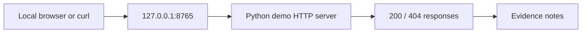

# Foundation Project 02 — HTTP Response Explorer

**Level:** Beginner · **Estimated time:** 30–60 minutes · **Cost:** Free if Python 3 is already available.

Learn HTTP status codes, response headers and localhost testing without installing Kali, Docker, a hypervisor or paid cloud services.

## Before you begin

Use a terminal on your own computer with Python 3. Do not expose the server to a public network or scan external sites. Your demo will bind to **127.0.0.1**, so requests stay on the loopback interface.

## Architecture



## Step 1 — Create a temporary folder

```bash
mkdir -p "$HOME/ghc-http-demo"
cd "$HOME/ghc-http-demo"
printf 'GoHackersCloud HTTP practice page\n' > index.html
```

**Expected:** `index.html` contains only synthetic demo text.

## Step 2 — Start the server

```bash
python3 -m http.server 8765 --bind 127.0.0.1
```

Leave this terminal running. **Expected:** Python reports it is serving HTTP on port 8765. You can stop the server with **Ctrl+C**.

## Step 3 — Observe the successful response

Open another terminal:

```bash
curl -i http://127.0.0.1:8765/
```

**Expected:** an HTTP `200 OK` status, response headers and your practice page. Server names and exact headers vary by Python version.

## Step 4 — Observe a missing resource

```bash
curl -i http://127.0.0.1:8765/not-here
```

**Expected:** a `404 File not found` response. Explain the difference between the requests in your own words.

## Step 5 — Inspect headers only

```bash
curl -I http://127.0.0.1:8765/
```

**Why:** `-I` sends a HEAD request and displays HTTP response headers without the body. Write down the status code and the meaning of `Content-Type` and `Content-Length` if present.

## Step 6 — Capture evidence

Create a short Markdown report with **Objective → Environment → Observations → Why it matters → Troubleshooting → Cleanup**. Do not publish your private hostname, unrelated user files or sensitive headers from real applications.

### Workplace connection

Understanding status codes and headers helps analysts interpret API behavior and establish evidence in an authorized web security assessment. A successful response **does not prove an application is secure**.

## Cleanup

Stop the server with **Ctrl+C**. In the terminal:

```bash
rm -f -- "$HOME/ghc-http-demo/index.html"
rmdir -- "$HOME/ghc-http-demo"
```

Only run cleanup if you created that directory for this exercise.

## Troubleshooting

| Problem | What to do |
| --- | --- |
| Port already in use | Stop your previous practice server before retrying |
| `python3` missing | Install Python from an official distribution or use another authorized Linux environment |
| `curl` missing | Use a local browser and browser developer tools instead |
| HTTP does not respond | Verify the server terminal is still running and the URL uses port 8765 |

[Foundation Projects](../README.md) · [Industry Practice](../../../industry-practice/README.md) · [Learn with GHC](../../../README.md)
