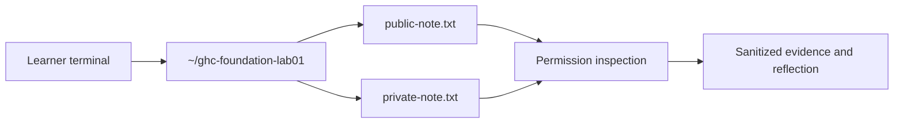

# Foundation Project 01 — Linux Security Fundamentals

**Level:** Beginner · **Estimated time:** 45–75 minutes · **Environment:** A Linux terminal you control; no Kali VM required.

**Goal:** understand Linux identity, file permissions, least privilege and evidence-based reporting through a harmless local practice environment.

> This is an original **local practice project**, not a production assessment and not a claim that a GHC hosted lab is required. Run commands only in a Linux environment you own or are permitted to use.

## What you will learn

- Identify the current user and working directory
- Explain owner, group and other permission bits
- Compare a broadly readable practice file with an owner-only file
- Apply least privilege to a deliberately created local file
- Explain findings in a report suitable for a learner portfolio
- Restore or remove the generated practice directory

## Prerequisites

A Linux shell with `whoami`, `pwd`, `ls`, `chmod`, `mkdir` and `rm`. Most standard Linux distributions have these. If you cannot install a VM, use an existing Linux environment you are authorized to access. A preconfigured GHC lab may also be suitable when your account offers one, but this exercise is independent.

## Architecture



All files contain **synthetic demonstration text**. No private user documents or real secrets are needed.

## Step 1 — Confirm where you are

```bash
whoami
pwd
id
```

**Why:** Linux decides access based on user and group identity. **Expected:** your own username, current directory and UID/GID information; actual values vary.

## Step 2 — Create an isolated workspace

```bash
mkdir -p "$HOME/ghc-foundation-lab01"
cd "$HOME/ghc-foundation-lab01"
printf 'This is a synthetic public practice note.\n' > public-note.txt
printf 'This is a synthetic private practice note.\n' > private-note.txt
chmod 644 public-note.txt
chmod 600 private-note.txt
ls -l
```

**Why:** `644` lets the owner read/write and others read; `600` lets only the owner read/write. Directory access permissions may also affect whether another user can reach a file.

**Expected:** `-rw-r--r--` for `public-note.txt` and `-rw-------` for `private-note.txt`. If your terminal or filesystem behaves differently, record the observation instead of assuming the command succeeded.

## Step 3 — Observe access policy

```bash
stat -c '%n %a %U:%G' public-note.txt private-note.txt
```

**Expected:** numeric modes `644` and `600`, plus your owner/group. On some non-GNU systems, `stat` uses different flags; `ls -l` remains a portable fallback.

**Question:** Why might a readable-but-not-writable file still expose confidential information?

## Step 4 — Improve least privilege

```bash
chmod 600 public-note.txt
ls -l public-note.txt private-note.txt
```

**Why:** for this demonstration, neither file needs access by the group or other users. Both should now be owner-only.

**Real workplace connection:** secure configuration reviews identify unnecessary access to logs, keys, configuration files and application data. This exercise illustrates the reasoning but is not a substitute for reviewing business requirements.

## Step 5 — Record evidence

Create a short report using [the evidence template](./REPORT-TEMPLATE.md) with:

- The environment and permitted scope
- The initial permissions
- What was changed and why
- Final permissions and a retest command
- A note about the limits of this synthetic example

**Never publish actual credentials or personal files.**

## Step 6 — Cleanup

Run only if you created the specified directory and it contains only this exercise's files:

```bash
cd "$HOME"
rm -f -- "$HOME/ghc-foundation-lab01/public-note.txt" "$HOME/ghc-foundation-lab01/private-note.txt"
rmdir -- "$HOME/ghc-foundation-lab01"
```

If the directory contains other files, `rmdir` safely refuses to remove it. Do not use recursive deletion for this exercise.

## Questions to check understanding

1. What does `chmod 600` mean?
2. Why is `chmod 777` generally a poor default?
3. What role do directory permissions play in file access?
4. Why should permissions be based on the business need rather than made restrictive blindly?
5. How would you describe a permissions finding to an administrator?

## Where to continue

- [Foundation Linux learning](https://foundation.gohackerscloud.com/)
- [Academy learning pathways](../../../academy/README.md)
- [From labs to security services](../../../industry-practice/README.md)
- [Portfolio building](../../../guidance/portfolio-building/README.md)

[Foundation projects](../README.md) · [Learning Hub](../../../README.md)
