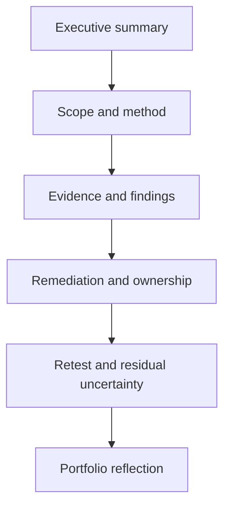

# Stage 05 — Executive Reporting and Portfolio Capstone

**Time:** 60–90 minutes · **Deliverable:** complete, clearly labeled synthetic security assessment report.

## Professional concept

Executives need a concise view of risk and decisions. Engineers need reproducible evidence and remediation criteria. The final report should serve both audiences without exaggerating what was proven.

## Report architecture

## Step 1 — Write an executive summary

Use three short paragraphs:
1. Why Northstar Demo requested a synthetic review.
2. What **two documentation-level control gaps** were observed.
3. What actions are proposed and why **no fix or real-world exploitability has been verified**.

## Step 2 — Describe scope

State the materials E-01–E-06, documentation-only review, no live systems and no real-world authorization or customer relationship.

## Step 3 — Attach evidence-backed findings

Provide F-01 and F-02 with their evidence IDs, observed requirements mismatch, plausible impact, uncertainty and proposed corrective action. Do not add unsupported severity scores.

## Step 4 — Build a leadership decision table

| Decision | Why it matters | Proposed owner | Status |
| --- | --- | --- | --- |
| Approve viewer role redesign | Protect integrity of report settings | Application owner | Awaiting fictional approval |
| Approve IAM least-privilege change | Reduce unnecessarily broad cloud access | Cloud identity owner | Awaiting fictional approval |
| Schedule authorized retests | Confirm controls work without breaking business tasks | Assessment coordinator | Not conducted |

## Step 5 — Publish responsibly

Your GitHub portfolio README should use a title such as **“Synthetic Security Review: Role-Based Access and Cloud IAM.”** Include a diagram, methodology, two finding summaries, remediation plan, limitations and learning reflection.

**Do not state:** "Audited a customer for GHC", "exploited Atlas Portal", "closed vulnerabilities", or "certified security controls". None of those claims is supported by this scenario.

## Capstone scoring rubric (100 points)

| Criterion | Points |
| --- | ---: |
| Clear permission boundary and scope | 20 |
| Accurate evidence traceability and uncertainty | 25 |
| Correct findings and business context | 20 |
| Actionable remediation and retest design | 20 |
| Professional reporting and sanitization | 15 |

A completion score measures the educational exercise, **not** job readiness, exam certification or eligibility to serve clients.

## Next learning steps

If you are ready for technical practice, move to relevant [CEH/OSCP/Cloud exercises](../../certification-practice/README.md) or authorized [GHC Labs](../../../ghc-labs/README.md) where your membership permits. Compare professional workflows with [GHC Cybersecurity Services](https://gohackerscloud.com/cybersecurity-services).

[Series index](../README.md) · [Career Guidance](../../../guidance/README.md)
