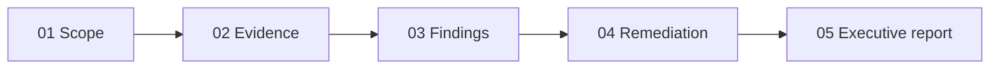

# GHC Professional Practice Series

**From guided learning to workplace-style security deliverables — without access to real customer environments.**

This original open learning series follows **Northstar Demo**, a completely fictional company. You will act as an analyst reviewing *synthetic evidence*. No live targeting, paid cloud accounts, Kali installation or special hardware are needed; Markdown and a text editor are enough.

> **Always label your outputs “Synthetic training scenario — not a real customer engagement.”** The series illustrates professional assessment discipline but neither qualifies you to deliver regulated services nor guarantees certification or employment.

## Five connected work packages

| Stage | Guide | Work product |
| --- | --- | --- |
| 01 | [Engagement planning and scope](./01-planning-and-scope/README.md) | Rules of engagement and asset register |
| 02 | [Evidence collection](./02-evidence-and-controls/README.md) | Evidence register and control observations |
| 03 | [Findings and prioritization](./03-findings-and-risk/README.md) | Two evidence-backed finding records |
| 04 | [Remediation and retesting](./04-remediation-and-retest/README.md) | Remediation tracker and validation plan |
| 05 | [Executive reporting and portfolio capstone](./05-capstone-report/README.md) | A complete synthetic assessment report |

## Scenario: Northstar Demo

The fictional organization operates a reporting application called **Atlas Portal**.

**Approved training scope:** analyze only the fictional facts below and the files in this series. There are no reachable addresses or real company systems to test.

| Evidence ID | Supplied synthetic observation |
| --- | --- |
| E-01 | Role matrix lists `viewer` with read and modify access to report settings |
| E-02 | Stated role requirement says `viewer` should read assigned reports only |
| E-03 | Example S3-style IAM policy grants `s3:*` on `*` |
| E-04 | Stated workload need is object read access under one fictional reports prefix |
| E-05 | Fictional change ticket proposes changing `viewer` to read-only |
| E-06 | Fictional IAM change ticket proposes limiting access to `s3:GetObject` in the reports prefix |

E-05 and E-06 are **proposals, not evidence that changes were made**. We have no live access logs, access tests, IAM simulation results, or production context. Be precise about this limitation in every report.

## The professional workflow

Each stage explains the business reason for the work, describes the synthetic evidence, and produces a practical artifact that can be reviewed.

## For self-paced students and instructors

**DIY:** Complete one stage at a time, store outputs in a local project folder, then compare your work with the acceptance criteria.

**Live class:** Assign a student as assessor, a partner as fictional application owner, and an instructor as reviewer. Everyone must keep the scenario synthetic and explicitly scoped.

**Reuse:** [Report templates](./templates/README.md) provide tables ready to copy into private student notes. Do not publish confidential information or represent these exercises as client work.

## Connecting to GHC

This series illustrates the structure of work relevant to [GoHackersCloud Cybersecurity Services](https://gohackerscloud.com/cybersecurity-services) such as assessment planning, security control review, reporting, remediation and retest. It does **not** provide customer access or claim that students perform GHC service engagements.

Continue with [Foundation](../../foundation/README.md), [Academy](../../academy/README.md), [GHC Labs](../../ghc-labs/README.md) where eligible, or [Career Guidance](../../guidance/README.md).

[All projects](../README.md) · [Learn with GHC](../../README.md)

## Turn the capstone into a reusable portfolio

After Stage 05, use the [student portfolio toolkit](../../student-portfolio/README.md) to structure your final report, document evidence and self-assess with the [student checklist](../../student-portfolio/checklists/STUDENT-COMPLETION-CHECKLIST.md). Instructors can provide feedback using the [100-point rubric](../../student-portfolio/instructor/ASSESSMENT-RUBRIC.md).

Template completion is educational progress, **not** proof of customer assessment experience or a third-party certification.
