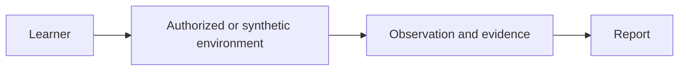

# [Project title]

**Training classification:** [Synthetic / Local sandbox / Explicitly authorized exercise]

**Author:** [Name or public alias]  
**Role focus:** [Security analyst / Pentester / Cloud security / Other]  
**Date completed:** [YYYY-MM-DD]

> This is a learner project. Do not claim that it represents production customer work.

## 1. Executive overview

**Problem:** What learning objective did this exercise address?  
**Outcome:** What did you actually observe or demonstrate?  
**Limitations:** What was outside scope?

## 2. Objectives

- [ ] [Learning objective 1]
- [ ] [Learning objective 2]
- [ ] [Learning objective 3]

## 3. Prerequisites and accessible alternatives

| Requirement | Used | Alternative for limited hardware |
| --- | --- | --- |
| Operating environment | [OS / browser] | [Text-only / sandbox alternative] |
| Tools | [Exact names and versions] | [Simpler approved tools] |
| Internet needed? | [Yes / No] | [Offline study option] |

## 4. Scope and permission

Describe the local environment or explicitly approved target. If using fictional evidence, clearly mark it **synthetic**.

**Not tested:** [Excluded assets, workflows and environments]

## 5. Architecture

Replace the diagram with a depiction of what you actually used; do not imply additional systems were deployed.

## 6. Methodology and reproducible steps

| Step | Action | Reason | Expected result | Actual result |
| --- | --- | --- | --- | --- |
| 1 | | | | |
| 2 | | | | |

Use fenced code blocks for actual, safe commands. Never include credentials, offensive actions outside permission or copied paid exercise answers.

## 7. Evidence and observations

| Evidence ID | Source | Observation | Confidence / limitation |
| --- | --- | --- | --- |
| E-01 | | | |

Link to sanitized screenshots or synthetic fixtures only.

## 8. Findings and improvements

| ID | Observed issue or lesson | Impact (if supported) | Improvement |
| --- | --- | --- | --- |
| | | | |

If no security issue was established, state **"No verified security vulnerability was established"** rather than inventing one.

## 9. Validation, cleanup and limitations

**What was confirmed:**  
**What remains unknown:**  
**Cleanup steps completed:**  
**What would require further authorization:**

## 10. Workplace relevance

Explain how the project relates to professional practice (scoping, secure configuration, assessment, documentation, remediation). Training exercises do not establish customer experience.

## 11. Personal reflection

- What did I learn?
- What would I do differently?
- What should I practice next?

## Publication checklist

Use the [student checklist](../checklists/STUDENT-COMPLETION-CHECKLIST.md) before sharing.

[Portfolio toolkit](../README.md)
